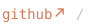
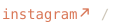

<!-- cards:start (generated by scripts/render_cards.py; edit the script, not this block) -->

 
 
 
 
<picture><source media="(prefers-color-scheme: dark)" srcset="./cards/title-code-dark.svg" /></picture> 

<!-- cards:end -->
