<!-- Animated cards: drawn by scripts/render_cards.py from real contribution data and
     refreshed daily by .github/workflows/profile-cards.yml. Edit the text in that script. -->

 
 
 

  

 

<!-- ⚙️ ANIMATED TECH STACK -->
<h2 align="center">🔮 Technological Arsenal</h2>

  <em>Languages, Frameworks, and Infrastructure engineered for high performance.</em>

  

  

 

<!-- 🐍 THE GITHUB SNAKE -->
<h3 align="center">🐍 Contribution Grid Snake</h3>

  <picture>
    <source media="(prefers-color-scheme: dark)" srcset="https://raw.githubusercontent.com/miyxotkem/miyxotkem/output/github-contribution-grid-snake-dark.svg">
    <source media="(prefers-color-scheme: light)" srcset="https://raw.githubusercontent.com/miyxotkem/miyxotkem/output/github-contribution-grid-snake.svg">
    
  </picture>

 

<!-- 📡 ENCRYPTED COMMS MATRIX -->
<h2 align="center">📡 Encrypted Comms Matrix</h2>

  <em>Direct transmission frequencies for engineering collaborations, research inquiries, and architecture discussions.</em>

  

  
  

<!-- FOOTER -->

  🛰️ <b>MIYXOTKEM MAINFRAME</b> // AUTONOMOUS UAV PERCEPTION & NEURAL SYSTEMS

